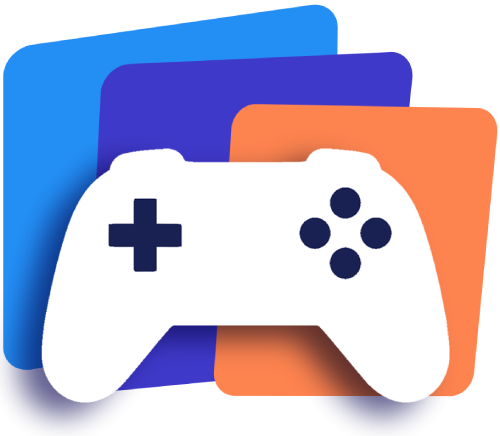
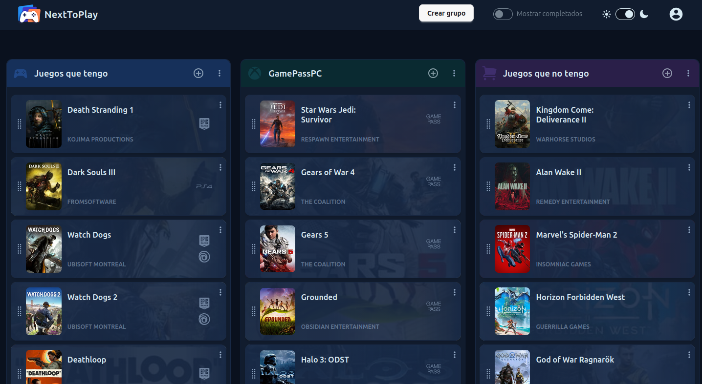
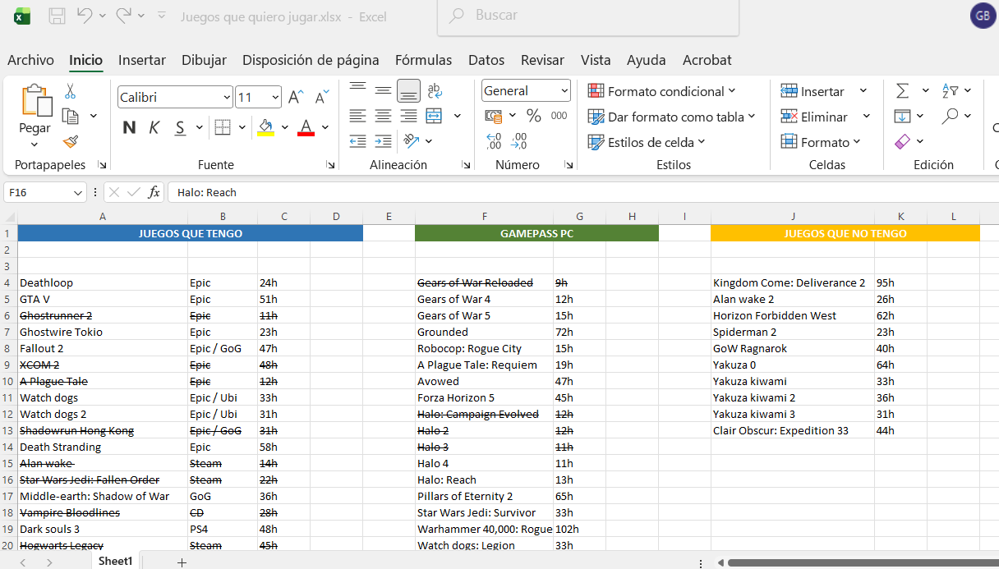
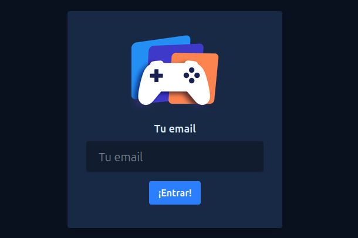
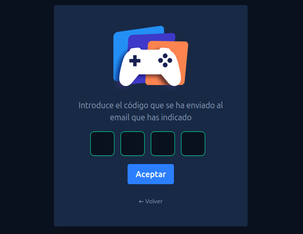
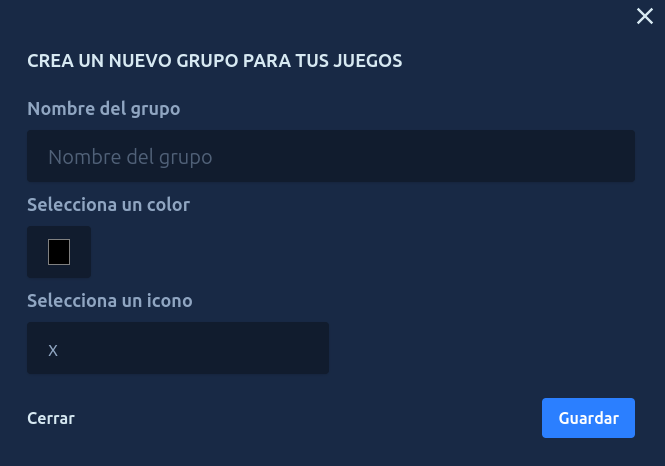
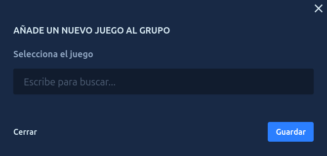
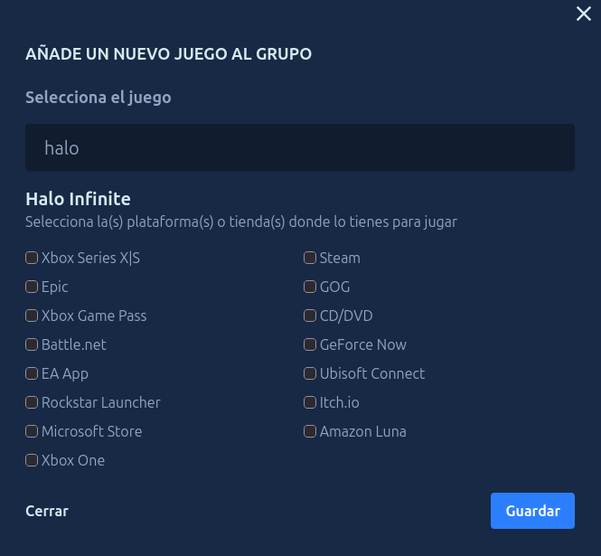
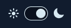

## Sobre NextToPlay

**NextToPlay** es una sencilla aplicación web ideada para resolver un problema habitual de los jugadores de videojuegos, especialmente aquellos que utilizan el PC como su plataforma principal: el análisis parálisis. 

Su objetivo es ayudarte a organizar tus juegos pendientes y reducir las opciones entre las que elegir, para que el tiempo libre que dedicas a jugar no se convierta en una tarea de planificación.

Puede verse en funcionamiento en un servidor gratuito (y lento) de Wasmer: [https://nexttoplay.wasmer.app/](https://nexttoplay.wasmer.app/)

## Qué es el Análisis Parálisis

A todos nos ha sucedido: acabas un juego y piensas «Voy a instalar el próximo. ¿cuál elijo?». Entras en tus bibliotecas llenas de juegos por las ofertas de Steam, regalos de Epic Games Store, la nostalgia de GOG... y te pasas horas sin acabar de decidirte. «Ya lo veré mañana», piensas. 

Esto es el llamado *análisis parálisis* o *parálisis por análisis*, capaz de provocar suficiente fatiga mental como para que tu cerebro te haga renunciar a lo que deseabas hacer. Y tiene dos consecuencias:
* Pierdes tu preciado tiempo libre en intentar tomar una decisión que nunca llega en lugar de jugar.
* Puedes acabar eligiendo cualquier juego para salir del bloqueo, aunque realmente no sea el que más te apetece y te acabes arrepintiendo.

## Cómo lo resuelve NextToPlay

Las soluciones a este bloqueo mental pasan por forzarte a seleccionar una opción en un corto periodo de tiempo (lo que puede ser muy difícil de hacer en mitad del bloqueo y dar una solución que no sea la adecuada), dejarlo en manos del azar (lo que puede dar como resultado la selección de un juego al que realmente no te apetece) o reducir la lista.

**NextToPlay** te ayuda a solucionarlo reduciendo la lista de alternativas. Con esta aplicación tendrás un listado organizado de aquellos juegos a los que **realmente** quieres jugar, una selección hecha en frío sin tener que tomar decisiones ni comparar:
* Añade los que realmente crees que te van a gustar y te quieres jugar.
* Organizados en grupos según tus propias preferencias.
* Olvídate de esas docenas de opciones que solo generan ruido mental. 
* Dedica tu tiempo a jugar y no a decidir.

Porque elegir un juego entre 100 es difícil, pero elegir un juego entre 10 que sabes que te gustan y quieres jugar es mucho más sencillo. Te llevará como mucho unos minutos. Además, sabrás que es un juego que te interesa y quieres jugar.

## Precedentes

La historia de esta aplicación comienza hace varios años, en 2023 o 2024. En un momento dado, tras acabar un juego, abrí Steam y me puse a mirar los juegos pendientes para decidir cuál descargar. Tras un largo rato mirándolos, viendo sus descripciones, buscando opiniones de algunos de ellos, no me convencía nada. Así que abrí el launcher de Epic, fui a su biblioteca... Llena de juegos que han regalado, los cuales siempre canjeo si no los veo muy malos. Por que «nunca se sabe». De nuevo más tiempo haciendo lo mismo. Seguía sin tener claro a cuál jugar, y aún me quedaba por ver GOG, EA, mi PS4... 

Esto es algo que ya me había pasado en otras ocasiones, pero entonces me dije 'no puede ser que me lleve horas decidir a qué jugar, estoy malgastando mi tiempo libre'. Así que volví a la primera página y empecé a recorrer la biblioteca con otro objetivo: ya no buscaba decidir un juego al que jugar, sino decidir por cada juego si realmente me interesaba o no veía que me fuese a apetecer nunca... Y así ir añadiendo los elegidos a favoritos, ¡para algo tenían esa función! Luego fui a Steam e hice lo mismo...

Pero aún no estaba contento. Ya había acotado las opciones a aquellas que realmente me generaban interés, pero no tenía una lista, sino una lista por cada plataforma o launcher. Eso no me resolvía el problema bien, así que recurrí a mi solución habitual para hacer listas 'cutres' pero rápidas y efectivas: el Excel. Y así encontré la solución a este problema por mí mismo. Apuntando la duración indicada en How Long to Beat añadía un dato que me ayudaba en la toma de decisiones: a veces apetece algo corto o por algún lanzamiento próximo no tendrás mucho tiempo, otras quieres meterte en una historia que te atrape durante semanas. 

¡Lo tenía! Un sitio donde consultar de un vistazo y sin distracciones todos mis juegos. Separando los que poseía de los disponibles en Game Pass, que al ser un servicio efímero e intermitente (solo lo tengo en ocasiones) jugaba con reglas distintas, siendo ignorados cuando está de baja y prioritarios cuando tengo acceso. Además, añadí una opción de futuribles, para no olvidar ese interés y buscar ofertas. Y desde entonces he estado utilizándolo, añadiendo los que entraban en mis bibliotecas y tachando los completados (por una manía personal de no borrar), dando este resultado:

## Historia y creación de NextToPlay

Tras muchos años trabajando como desarrollador web, los últimos con WordPress, me sentía estancado. La mayoría de aplicaciones en las que trabajé se habían empezado antes de llegar yo y tenían un desarrollo anárquico, en *spaghetti code*, y en la necesidad profesional de una microempresa de seguir siempre adelante no había opción a rehacerlas. En la única aplicación que pude empezar antes de volcarnos en las páginas web utilicé un MVC extremadamente sencillo, que mejoraba la estructura pero no me sacaba de los malos vicios adquiridos. 

Ahora, en 2026, tras centenares de páginas web corporativas en WordPress, cansancio y un cierto grado de conformismo, decidí renovar mis conocimientos de programación para ponerme al día. Pero esta vez partiendo de un sistema estructurado. Ante mi desconocimiento de tecnologías modernas, discutí con Gemini y ChatGPT el camino a seguir y ambas herramientas coincidieron en la misma recomendación: aprovechar mi base para modernizarme y empezar a utilizar Laravel, uno de los frameworks de programación web más utilizados, 

Dicho y hecho, a finales de verano comencé a aprender a utilizar este framework tan distinto a la forma en l que había programado hasta entonces. Pero con ver vídeos y leer no iba a conseguir nada, necesitaba plasmarlo en una aplicación que hiciese por mi cuenta. Podía hacer algo genérico y aburrido que aplicase los conocimientos adquiridos, ¡pero no quería eso! Ese camino llevaba a cansarme y abandonar. Necesitaba encontrar algo que me apeteciese crear.

Y un día, al abrir mi Excel para decidir qué jugar... de repente lo vi claro. El archivo que hice era una herramienta sencilla y genial, aunque en su sencillez también era fea y debía rellenar todo a mano. Era fácil de convertir en una aplicación web, y lo más importante... ¡podía quedar muy chulo! Ya tenía mi motivación.

Hoy, dos meses después de empezar a aprender Laravel, puedo dar por terminada esta **primera versión**. Porque la aplicación para sustituir al excel ya está hecha, pero aún quedan varias ideas y mejoras por aplicar, así como nuevas tecnologías que incorporar en próximas versiones.

## Características principales

Estas son las funcionalidades principales de la aplicación:
* Acceso mediante código: La aplicación no pide ni guarda tu contraseña. El acceso se hace mediante código enviado al correo electrónico del usuario.
* Búsqueda de videojuegos mediante IGDB: Los datos de los juegos se obtienen directamente de las bases de datos de Twitch.
* Duración de los videojuegos a través de How Long To Beat: Muestra las tres estimaciones de duración (historia principal, historia más secundarias, completista).
* Grupos totalmente personalizados: crea los grupos que necesites y personaliza su nombre, color e icono.
* Organización de los juegos en un tablero tipo Kanban: mueve y reordena tus juegos, conservando los cambios.
* Modo diurno y nocturno

## Cómo funciona

### Acceso

El acceso a la aplicación se realiza mediante correo electrónico. Basta con introducir la dirección de email para recibir un código de acceso que deberás introducir en la siguiente pantalla. Si tu email es nuevo, creará un nuevo usuario.

**Nota**: Por motivos de seguridad esta acción está limitada a 3 por minuto, superar este límite generará un error 429 e impedirá el acceso durante un minuto.

<table>
  <tr>
    <td align="center">
      <strong>Introduce tu email</strong>
        
      
    </td>
    <td align="center">
      <strong>Introduce el código</strong>
        
      
    </td>
  </tr>
</table>

### Añadir un grupo

Una vez iniciada la sesión, el usuario puede crear grupos nuevos pulsando sobre el botón "Crear Grupo" en la cabecera de la aplicación. Un usuario nuevo debe añadir un grupo antes de cualquier juego, en este caso también verá un botón para hacerlo en el centro de la pantalla.

La creación de grupos consta de tres campos, dos de ellos obligatorios:

* Nombre del grupo (obligatorio): Nombre personalizado. Un usuario no puede tener dos grupos con el mismo nombre.
* Selecciona un color (obligatorio): Campo para seleccionar el color de fondo que tendrá la cabecera del grupo. Se abrirá una ventana del navegador con distintas opciones y la posibilidad de seleccionar cualquier color RGB.
* Selecciona un icono (opcional): introduce un texto de búsqueda y se mostrarán hasta 30 iconos cuyo nombre coincida. Selecciona el deseado pulsando sobre él.

Con los campos rellenos, pulsando "Guardar" comprobará la validez de los datos y, si son correctos, recargará el tablero con el nuevo grupo creado.

### Añadir un juego

Para añadir un nuevo juego a un grupo, el usuario puede pulsar sobre el icono + en la cabecera o el botón 'Añadir juego' en el pie de la columna.

El proceso se divide en 2 partes:

1. Introduce el texto de búsqueda en el campo. La aplicación consultará el catálogo de IGDB y se mostrarán las 10 mejores coincidencias. Al pulsar sobre el deseado se seleccionará y se mostrarán las plataformas y launchers en los que está disponible.

2. Se seleccionan la(s) plataforma(s) en la(s) que se posee el juego. Esta parte es opcional, se permite no seleccionar ninguna plataforma. Esto es útil, por ejemplo, para juegos pendientes de compra en los que no se sepa dónde se adquirirá.

Finalmente, al pulsar guardar el tablero se recargará con el nuevo juego añadido.

### Opciones de grupos

En la cabecera de los grupos se puede desplegar el menú pulsando sobre el icono ⋮. Esto mostrará un cuadro con dos opciones:

* Editar grupo: se abrirá una pantalla similar a la de creación donde se pueden modificar sus datos.
* Eliminar grupo: elimina el grupo del usuario y todos los juegos que contiene.

### Opciones de juegos

En la parte derecha de cada juego aparece el icono ⋮. Al pulsar sobre él se desplegará el menú del juego: 

* Finalizado / Quitar finalizado: se mostrará una u otra opción según el estado del juego. Permite marcar (o desmarcar) el juego como finalizado, lo que lo ocultará si no está seleccionada la opción 'Mostrar completados' en la cabecera.
* Editar: permite introducir un nombre personalizado para el juego, cambiar su estado de finalizado y modificar las plataformas y launchers en los que se posee.
* Quitar: elimina por completo el juego del tablero del usuario.

### Movimiento de juegos

La aplicación utiliza un tablero de tipo kanban, lo que significa que las tarjetas de los juegos pueden moverse en su grupo para cambiar su orden y moverse entre grupos. 

Para hacerlo, el usuario debe pulsar sobre el icono ⦙⦙ en la tarjeta del juego que desea mover y, manteniendo el botón del ratón presionado, arrastrarlo a la posición en la que desee colocarlo.

### Cambiar tema noche/día

En la cabecera de la aplicación se encuentra el interruptor que permite cambiar entre los temas oscuro y claro con solo pulsar en él

## Tecnologías utilizadas

En la realización de esta aplicación se han utilizado las siguientes tecnologías:
* PHP 8.3
* Laravel v13
* Blade
* Alpine.js
* Tailwind CSS y DaisyUI
* SQLite (MySQL en producción)
* API de IGDB
* Pest con Playwright para pruebas

